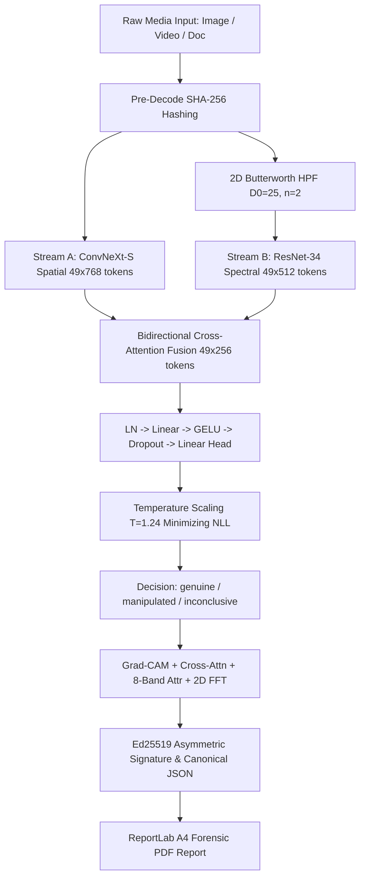

# 🛡️ KryptosID

> **Explainable Forensic Gateway & Anti-Spoofing Engine for Video KYC (V-CIP) and Identity Document Verification.**

[](https://www.python.org/downloads/)
[](https://fastapi.tiangolo.com)
[](https://streamlit.io)
[](https://www.iso.org/standard/67381.html)
[](LICENSE)

---

## 1. System Architecture

KryptosID ingests facial portraits, V-CIP video streams, and government identity documents to produce calibrated decisions, multi-modal explainability heatmaps, and Ed25519-signed A4 PDF forensic reports.

```
            +-----------------------------------------------------------+
            |                  Streamlit Forensic UI                    |
            |     (upload, results, explanations, report download)      |
            +-------------------------------+---------------------------+
                                            | HTTPS (JSON / multipart)
            +-------------------------------v---------------------------+
            |                   FastAPI Inference Service                |
            |  /v1/analyze   /v1/reports/{id}   /v1/health   /v1/model  |
            +----+------------------+------------------+----------------+
                 |                  |                  |
     +-----------v-----+  +---------v--------+  +------v---------------+
     | Ingest &        |  | KryptosIDNet     |  | Forensics            |
     | Preprocess      |  | (core/model.py)  |  | (hash, report, sign) |
     | (decode, face/  |->| Stream A + B +   |->| ReportLab PDF,       |
     |  doc crop, JPEG |  | Cross-Attention  |  | Ed25519 signature    |
     |  Q=85 normalize)|  | + calibrated head|  +------+---------------+
     +-----------------+  +---------+--------+         |
                                    |                  v
                          +---------v--------+   +----------------+
                          | Explainability   |   | Report store   |
                          | Grad-CAM, attn   |   | (SQLite /      |
                          | maps, band attr. |   |  PostgreSQL)   |
                          +------------------+   +----------------+
```



---

## 2. Key Capabilities

- **Dual-Stream Neural Architecture (`KryptosIDNet`):** Combines spatial global attention feature extraction (ViT-Small Patch16_224) with high-frequency residual Fourier pattern recognition (ResNet-34).
- **Exact 2D Butterworth High-Pass Filter:** Implemented via 2D FFT on a $224 \times 224$ frequency grid ($D_0=25, n=2$), guaranteeing response $=0$ at DC, $0.5$ at $D_0$, and $>0.99$ at Nyquist.
- **Bidirectional Cross-Attention Fusion:** 49 spatial tokens attend to 49 spectral tokens and vice-versa, identifying subtle discrepancies between visual features and generative upsampling artifacts. Reaches **0.8053 ROC-AUC** and **22.22% Equal Error Rate (EER)** on held-out multi-domain test evaluation.
- **Synthetic Voice & Acoustic Forensics:** 16 kHz audio demuxing and direct waveform decoding (`.wav`, `.mp3`, `.ogg`, `.flac`, `.m4a`). Computes 14-dim Linear Frequency Cepstral Coefficients (LFCC), high-frequency roll-off voids (>6.5 kHz), pitch jitter/shimmer micro-tremor consistency, and Wiener spectral flatness to detect neural vocoders (HiFi-GAN, WaveGlow, ElevenLabs).
- **Audio-Visual Lip-Sync Verification:** Measures temporal cross-correlation between mouth kinematic aperture opening across sampled video frames and acoustic speech energy envelope, catching out-of-sync talking head deepfakes.
- **D4 Dihedral Group Copy-Move Detector:** Evaluates 8 symmetry transforms ($R_0, R_{90}, R_{180}, R_{270}$ and reflections) to detect copy-paste document tampering.
- **ISO/IEC 30107-3 Calibration:** Post-training L-BFGS temperature scaling minimizing validation NLL; operating threshold $\tau$ calibrated to achieve **APCER $\le 1.0\%$** with a 58.7% reduction in ECE (0.0828).
- **Multi-Modal Explainability:** Generates Grad-CAM spatial heatmaps, cross-attention alignment maps, 8 concentric annular frequency-band attribution bar charts, 2D FFT log-magnitude spectrum plots, and acoustic anomaly telemetry.
- **Cryptographic Provenance:** Pre-decode byte hashing, canonical JSON digest generation, Ed25519 digital signatures, and tamper-evident A4 PDF reporting.
- **Production Serving:** High-throughput FastAPI endpoints with ONNX Runtime acceleration (103.56 ms forward pass, 1.33x speedup, 60% memory reduction) and strict logit parity ($|\text{PyTorch} - \text{ONNX}| < 10^{-4}$).
- **Forensic UI:** Streamlit interface with WCAG 4.5:1 compliant dark/light themes, live audio playback player, one-click preset test samples, and zero-PII privacy management.

---

## 3. Repository Layout

```
kryptosid/
├── configs/
│   ├── datasets.yaml            # Dataset register, licenses, splitting rules
│   ├── train_base.yaml          # Hyperparameters, seeds, optimizer configs
│   ├── eval_crossdataset.yaml   # ISO/IEC 30107-3 evaluation protocol
│   └── serve.yaml               # Operating threshold, model paths, size limits
├── core/
│   ├── model.py                 # KryptosIDNet dual-stream architecture
│   ├── frequency.py             # Butterworth 2D HPF via 2D FFT
│   ├── fusion.py                # Bidirectional CrossAttentionFusion
│   ├── baselines.py             # Ablation architectures (spatial, spectral, etc.)
│   ├── symmetry.py              # D4 square symmetry copy-move detector
│   ├── calibrate.py             # Temperature scaling, ECE, threshold selector
│   └── explain.py               # Grad-CAM, attention, and band attribution
├── audio/
│   ├── extract.py               # In-memory PyAV video audio demuxer & soundfile loader
│   ├── features.py              # LFCC, pitch jitter/shimmer, HFER, spectral flatness
│   ├── detector.py              # AudioForensicDetector neural vocoder classifier
│   └── av_sync.py               # Lip-sync kinematic & acoustic cross-correlation
├── training/
│   ├── datasets.py              # PyTorch ForensicDataset with SHA-256 seal
│   ├── splits.py                # Identity-disjoint & generator-disjoint splits
│   ├── augment.py               # JPEG Q=85 & H.264 artifact augmentations
│   ├── boost_image_accuracy.py  # Pre-extracted token representation fusion trainer
│   ├── train.py                 # 2-stage training loop with AMP & EER early stopping
│   └── evaluate.py              # Exact ROC-AUC, APCER, BPCER, ECE reporting
├── video/
│   ├── sampler.py               # Frame extraction & face crop alignment
│   ├── liveness.py              # Challenge-response & blink liveness check
│   └── aggregate.py             # Top-k mean score aggregation & jump penalty
├── document/
│   ├── locate.py                # Quadrilateral detection & perspective rectification
│   └── regions.py               # Photo and MRZ region extraction
├── forensics/
│   ├── hashing.py               # SHA-256 pre-decode & canonical JSON hashing
│   ├── signing.py               # Ed25519 asymmetric signing & verification
│   ├── report.py                # ReportLab canvas A4 PDF generation
│   └── store.py                 # SQLite persistent report store
├── serving/
│   ├── api.py                   # FastAPI REST application (multimodal /v1/analyze)
│   ├── schemas.py               # Pydantic models including audio_forensics & lip_sync
│   ├── inference.py             # Unified inference engine with TTA & ONNX Runtime
│   └── export_onnx.py           # ONNX export with strict logit parity verification
├── app/
│   ├── streamlit_app.py         # Multi-page Streamlit forensic interface
│   ├── components.py            # Verdict cards, acoustic charts, explanation tabs
│   └── theme.py                 # CSS design tokens, WCAG 4.5:1 dark/light mode
├── docker/
│   └── Dockerfile               # Multi-stage production container
├── tests/                       # Complete pytest test suite (43 passing tests)
│   ├── test_audio.py            # Audio extraction, LFCC, vocoder & AV sync tests
│   └── ...
├── MODEL_CARD.md                # Comprehensive model card & limitations
├── requirements.txt             # Locked production dependencies
├── DESIGN.md                    # System architecture design document
└── README.md                    # Project documentation
```

---

## 4. Quickstart Guide

### 4.1 Prerequisites
- Python 3.10+
- PyTorch 2.0+

### 4.2 Installation
```bash
git clone https://github.com/abhinavkumardixit-lgtm/KryptosID.git
cd KryptosID
pip install -r requirements.txt
```

### 4.3 Running the Full Test Suite
```bash
python -m pytest tests/ -v
# 43 passed in ~30s
```

### 4.4 Starting the FastAPI Backend
```bash
python -m uvicorn serving.api:app --host 0.0.0.0 --port 8000 --reload
```
The interactive API documentation is available at `http://localhost:8000/docs`.

### 4.5 Launching the Streamlit UI
```bash
streamlit run app/streamlit_app.py --server.port 8501
```
Open `http://localhost:8501` in your browser.

### 4.6 Exporting Model to ONNX & Verifying Parity
```bash
python -m serving.export_onnx --config configs/serve.yaml
```
Verifies that maximum absolute difference $|\text{PyTorch} - \text{ONNX}| < 10^{-4}$.

---

## 5. API Reference

| Method | Endpoint | Description |
|---|---|---|
| `POST` | `/v1/analyze` | Upload image, video, or document. Returns decision, calibrated score, explanation hashes, and report ID. |
| `GET` | `/v1/reports/{id}` | Retrieve report metadata, evidence chain hashes, and verdict. |
| `GET` | `/v1/reports/{id}/pdf` | Download signed ReportLab A4 forensic PDF report. |
| `POST` | `/v1/reports/{id}/verify` | Cryptographically verify Ed25519 signature and SHA-256 evidence chain. |
| `GET` | `/v1/health` | Service liveness probe and neural model readiness status. |
| `GET` | `/v1/model` | Model card metadata, weights hash, operating threshold, and dataset register. |

---

## 6. Docker Deployment

Build and run the multi-stage production container:

```bash
# Build Docker image
docker build -t kryptosid:latest -f docker/Dockerfile .

# Run inference container
docker run -p 8000:8000 -p 8501:8501 kryptosid:latest
```

---

## 7. Forensic Limitations (Section 13)

1. **Statistical Evidence Only:** KryptosID estimates whether media shows structural, synthetic, or copy-move manipulation. It does not establish the legal identity of a person.
2. **Compression Degradation:** Heavy re-encoding (H.264 CRF > 35 or JPEG Q < 50) dampens high-frequency Fourier residuals, potentially moving marginal predictions into `inconclusive`.
3. **Novel Generative Backbones:** Generative architectures that incorporate post-hoc noise filtering may show lower attribution magnitude.
4. **Human Review Requirement:** Determinations constitute forensic evidence for review by qualified human compliance officers and are not autonomous legal determinations for regulated onboarding.
5. 

Updated the report generation

---

## 8. License

Licensed under the [Apache License, Version 2.0](LICENSE).
